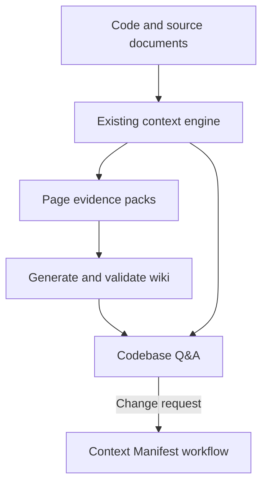

**DeepWiki-style repository intelligence for the Brownfield Starter Kit**

Implementation plan · 3 November 2026 · No starter-kit or application code changed

Add a generated repository wiki and source-grounded Q&A as a consumer of the context engine. Reuse the existing code/service graphs, hybrid retrieval, document knowledge base and refresh evidence. Keep the Context Manifest workflow responsible for impact analysis, change scope and approvals.

The initial deliverable should support local application folders and the current working tree. The plan does not require publishing a repository to GitHub, uploading it to DeepWiki or introducing another graph database.

**Reference behavior and recommended scope**

Cognition documents DeepWiki as generated repository documentation with architecture diagrams, source links and codebase questions. Its steering file can specify a page hierarchy and page purposes. Its public MCP surface offers wiki structure, wiki contents and questions about public repositories. These are useful product patterns; this plan implements a local capability in your kit using your own evidence and workflows. See the [official wiki documentation](https://docs.devin.ai/work-with-devin/deepwiki) and [MCP documentation](https://docs.devin.ai/work-with-devin/deepwiki-mcp).

| Feature | First implementation | Later extension |
|---|---|---|
| Navigable wiki | Application overview, one guide per service, important flows, configuration/contracts, tests and known gaps | Additional subsystem pages selected from size and evidence |
| Diagrams | Service topology and bounded module/dependency diagrams generated from recorded edges | Trace-backed sequences and interactive graph exploration |
| Source citations | File/symbol/line references tied to content hashes and a snapshot | Git-provider links and comparison between snapshots |
| Codebase Q&A | Explain, locate and inspect possible impact using current evidence | Longer bounded investigations across services |
| Refresh | Track page dependencies and regenerate affected pages | Background refresh and larger repositories |
| Agent access | Python CLI and Claude Code commands | Local MCP adapter over the same functions |
| Browser experience | Navigation, article, diagram, source panel and question panel | Authenticated team hosting and role-specific views |

For the first multi-service demo, aim for an application overview, one page per enabled/discovered service, one important cross-service flow, and a tests/configuration guide. Page count should follow evidence and usefulness, not one page per symbol.

**Fit with the supplied kit**

| Existing component | Reuse | Required addition |
|---|---|---|
| `common.py` | Service registry, symbols, source locations, configuration and source-state digest | A snapshot-aware read adapter and canonical evidence references |
| `service_graph.py` | Services, APIs, topics, dependency edges and existing Markdown/Mermaid renderer | Smaller page-specific diagrams with provenance and unknowns |
| `enrich_graph.py` | Symbol metadata, routes, rule links and summaries | Fetch full bounded source spans for documentation; do not rely only on the 700-character embedding prefix |
| `semantic_index.py` | Code/rule/API/topic/doc retrieval, FAISS, BM25 and embedding model | A query orchestrator that combines retrieval with typed evidence expansion |
| `knowledge_base.py` | Cited passages from supplied knowledge documents | Preserve original source/version and distinguish documented intent from implemented behavior |
| `refresh.py` | Input digests, freshness checks, lock and refresh result | Mark affected wiki pages stale after successful core refresh; optionally run a separate wiki build |
| `manifest.py` | Impact, confidence/risk policy, scope and workflow | Optional derived wiki references for orientation; original source evidence still drives the decision |
| `documentation-agent.md` | Existing documentation role | Add a `wiki` mode with evidence-pack inputs and structured draft outputs |
| `/application-summary` | Delivery/test summary | Link to the wiki if present; keep its delivery-summary purpose |

The wiki can be introduced without waiting for a complete manifest-v2 migration. It does need reliable snapshot references, citation resolution and explicit separation of generated text from source evidence. Correct the previously reviewed completeness/workflow defects before displaying their results as trusted wiki facts. Configuration-only questions should be an acceptance case for the configuration retrieval improvement already proposed.



The wiki provides orientation. Q&A also retrieves current original evidence. A question never grants permission to modify code; implementation requests continue through the existing manifest and gates.

**Build pipeline**

1. **Select a source snapshot.** Run the existing core freshness check; refresh when requested through the normal command flow. Capture source-state digest, base commit, graph/index identities and relevant document/test/runtime versions. Read immutable inputs or copy the required evidence spans and verify their hashes before publishing. Abort/retry when inputs change during the read. Do not hold the core refresh lock while waiting for an LLM.

2. **Plan pages from the inventory.** Use the service registry, APIs/events, module groups and shared-library boundaries. Always include service overviews; add flow pages only when there is supporting evidence. Large services can be subdivided using graph communities and source folders. Allow a human-maintained `config/wiki.yaml` to select pages, purposes, source selectors, exclusions and bounded page sizes. This is documentation steering, not permission to invent behavior or change code.

3. **Assemble a bounded evidence pack for each page.** Include relevant entity records, source spans, dependency edges, contracts, configuration definitions, business-rule references, selected tests and unresolved links. Preserve source kind and authority. A Jira statement can establish requested behavior, a source branch can establish implemented logic, and a test can establish an asserted expectation; do not silently treat them as interchangeable. Record the query selectors and candidate-set fingerprints as well as the records actually read.

4. **Produce structured drafts.** The documentation agent or a configured generator receives the page purpose, evidence pack and output contract. It returns sections, claims, evidence IDs and unknowns. Ask it to explain decisions only when a cited ADR, issue or comment supports that history. The agent cannot create authoritative graph edges or business rules. Use the existing Claude Code workflow for the initial generator; put unattended model calls behind a provider interface later.

5. **Render deterministic parts.** Generate API tables, configuration tables, source links and diagrams from validated evidence IDs. The model may choose which existing nodes to explain; the renderer validates those selections. Dependency topology does not prove execution order. Use a flowchart unless code order or trace parent/child relationships support a sequence diagram. Distinguish static/name-based edges from observed runtime edges and show the observation window where relevant.

6. **Validate.** Check schema, page IDs, source hashes, line ranges, entity/edge references, diagram syntax, prohibited paths and the claimed snapshot. Validate that every implementation claim has supporting evidence or is clearly marked inference/unknown. A valid citation only proves the source exists: semantic support still requires a claim review, with sampled human checks in the pilot. Reject unsupported definitive claims and fabricated diagrams. Allow at most a small bounded repair pass before marking the page incomplete.

7. **Publish a coherent generation.** Write pages, evidence manifests, navigation and optional wiki-search index into a temporary generation. Validate the entire registry, then atomically change a `current.json` pointer. Readers retain the generation they opened. On failure, keep the prior version with an explicit freshness status; never label an old generation as current evidence.

**Page contents and data contract**

A service page should answer: what the service does; its entry points; important implementation modules; data/configuration; inbound and outbound interactions; business rules; tests; and known gaps. Owners and runtime characteristics appear only when recorded. An empty consumer list means no consumer was found in the declared boundary, not proof that none exists.

Keep the Markdown presentation separate from its machine-readable evidence manifest. A proposed page record is:

```yaml
schema_version: "1.0"
page_id: services.catalogue
title: Catalogue service
parent_id: application
kind: service
services: [catalogue]
source_snapshot_id: "<snapshot used to generate text>"
verified_snapshot_id: "<snapshot whose inputs were checked>"
state: fresh
generation:
  generator: "<configured agent or model>"
  prompt_version: "wiki-page-v1"
  policy_digest: "<digest>"
input_fingerprint: "<digest of evidence and selectors>"
content_digest: "<digest of rendered page>"
evidence_refs: [E-1, E-2]
selectors:
  - kind: service_inventory
    service: catalogue
    result_digest: "<digest including new and removed members>"
claims:
  - id: C-1
    text: "<implementation explanation>"
    support: direct
    evidence_refs: [E-1]
unknowns: []
```

Each evidence record should contain source kind, repository/service, relative path or source URI, qualified symbol when present, numeric line span/page/section, content hash, snapshot/version and resolution mode. Document evidence retains its original source locator. Runtime evidence retains observation timestamps and coverage limits. Store spans needed to resolve local citations for the published snapshot, or explicitly mark them unavailable; never silently show different current lines under an old citation.

Use stable page IDs independent of page titles. Evidence identity should not depend on a line number alone. For reused pages, keep the original generation snapshot and record verification against the new one separately. Relocated source references can be remapped and revalidated without unnecessarily regenerating prose.

**Storage and the generated-document feedback problem**

Use these proposed application-relative paths:

| Path | Purpose |
|---|---|
| `config/wiki.yaml` | Human-controlled page plan and generation policy |
| `artifacts/wiki/generations/<generation>/registry.json` | Navigation, page states and evidence references |
| `artifacts/wiki/generations/<generation>/pages/` | Generated Markdown |
| `artifacts/wiki/generations/<generation>/evidence/` | Page dependencies, claims, captured source spans and citations |
| `artifacts/wiki/current.json` | Atomic pointer to the published generation and optional index identity |
| `graphs/wiki/<generation>/` | Optional separate wiki-summary retrieval index |
| `var/wiki/` | Temporary jobs, caches and validation results |

The current kit recursively reads Markdown from `docs/`, and source-state hashing includes documentation inputs. Putting generated pages in those roots could make them re-enter discovery, count as independent grounding or repeatedly invalidate builds. Keep generated wiki artifacts outside human-document roots and explicitly exclude them from primary graph/corpus/KB inputs even when users broaden their roots. Treat these exclusions as an invariant, not merely a suggested glob.

For initial wiki-page search, reuse BM25 over page titles, headings and summaries. Add a separate FAISS wiki index only if semantic page routing needs it. Do not duplicate all source-code chunks there. Wiki hits may route to source entities; expand their evidence references and verify those original sources. Deduplicate corroboration by original evidence ID, so a rule and three generated pages repeating it count as one source.

Human corrections belong in the steering file, an annotation record or authoritative source documentation. Regeneration must not overwrite them. Generated pages are never silently promoted into approved business rules or used to raise manifest confidence.

**Q&A and agent query flow**

The question engine should expose explain, locate and potential-impact modes. All are read-only.

1. Resolve the current snapshot and any requested service/page. Classify the question sufficiently to choose evidence types, without assuming the user's vocabulary matches symbols.
2. Retrieve relevant wiki sections for orientation and code/config/contract/document evidence from existing retrieval. Exact identifiers remain useful; paraphrases can supplement semantic retrieval.
3. Expand a bounded set of relationships needed for the question: callers, callees, response/request types, mapper links, publishes/consumes, configuration readers and test links where the extractor can actually establish them. Label unresolved or name-based relationships. These typed edges are an extension where the current adapters do not produce them.
4. Fetch source spans at the pinned snapshot. Filter superseded or inaccessible evidence; report missing parser/consumer coverage. Record retrieval and traversal limits.
5. Answer from original evidence, citing it. Return relevant dependency paths, unknowns, freshness and truncation. A wiki page may be cited as an overview, but behavioral conclusions should resolve to its underlying evidence.
6. For a requested change, offer the normal `/build-context` route. Seed suggestions are candidates for that workflow; the wiki cannot populate approved edit scope by itself.

Proposed result fields are `answer`, `snapshot_id`, `citations`, `related_entities`, `dependency_paths`, `unknowns`, `freshness` and `truncation`. Prefer these observable fields over an LLM's unsupported numerical confidence score.

**Illustrative catalogue example**

Suppose a user asks: “If discontinued items are hidden, where could ordering behavior change?” The question does not name the implementation method.

Wiki-page retrieval locates the catalogue overview and product-availability flow. Hybrid code/config retrieval finds candidate filtering logic or configuration readers. Source inspection establishes the actual endpoint and response behavior. Service-graph evidence identifies any recorded callers; the engine follows those clients into ordering code and relevant tests. The answer describes what is established, shows the source-backed path, and identifies unknown external consumers.

Names such as `CatalogueService.listProducts`, `ProductClient` or `OrderValidator` would be illustrative until found in the target repository. Do not bake them into the implementation. A list-endpoint filter also does not automatically prove that checkout rejects unavailable items; that conclusion requires evidence from the ordering path. This is the practical value of combining the wiki with graph expansion and source reads.

**Incremental refresh**

Maintain both an inverted dependency map from source entity/file/edge/document to pages and a fingerprint of each page's discovery selectors. Tracking only cited files misses a newly added endpoint that has never appeared on a page.

| Change | Expected wiki response |
|---|---|
| Function behavior changes | Invalidate pages that read that function and affected flow summaries |
| New API/topic/service | Re-evaluate the appropriate inventory selector and navigation; create/update affected pages |
| Symbol renamed or removed | Invalidate/remap citations; remove obsolete page references; tombstone removed entities |
| Contract or config definition changes | Update relevant service/API/consumer pages supported by dependency evidence |
| Source document changes | Rebuild pages whose cited passages or discovery selectors depend on it |
| Lines move but meaning is unchanged | Remap locations and validate references; reuse prose and embeddings when valid |
| Only wiki layout/prompt changes | Invalidate the affected wiki generation policy, without re-extracting unchanged application code |
| Test or runtime evidence changes | Re-evaluate pages that used it based on its own digest/version, even if code is unchanged |

After the core refresh succeeds, mark affected wiki pages stale immediately. Generation may then run explicitly or as an enabled post-refresh stage. A core refresh can succeed while wiki regeneration fails: report those as separate statuses. Q&A should skip stale wiki claims and retrieve current original evidence, or explicitly answer about an older named snapshot. It must not combine fresh source and stale prose as though they were one consistent version.

For a persistent browser/MCP server, bind semantic-index, symbol and service-graph caches to snapshot identity. Existing no-argument/module caches must not survive another process's refresh unnoticed. Start with short-lived request workers if that is simpler for the pilot. Verify publication fingerprints before switching generations.

**Commands and tools to add**

These names are proposals; they are not commands already implemented in the kit.

| Surface | Proposed operation | Responsibility |
|---|---|---|
| Claude Code | `/build-wiki [service\|all]` | Plan, gather evidence, draft, validate and publish |
| Claude Code | `/ask-codebase "question"` | Read-only answer with source references and unknowns |
| CLI | `wiki.py plan`, `pack`, `validate`, `publish`, `status` | Deterministic build steps callable by agents or a model provider |
| CLI | `wiki.py query` | Prepare/retrieve evidence; return structured answer when a generator is configured |
| Local app | `wiki_server.py` | Serve the published wiki, citations and optional Q&A |
| Future MCP | `read_wiki_structure`, `read_wiki_page`, `ask_codebase`, `get_evidence` | Bounded access with page/section IDs, snapshot IDs and pagination |

Extend the six existing brownfield commands only at clear integration points: setup can optionally prepare the initial wiki; refresh marks it stale; build-context can use verified wiki references for orientation; evaluate-change can report documentation freshness when the change plan required documentation. Preserve the existing change gates. Implement these calls in the commands/tools, rather than relying on the current Cursor-format hooks to fire in Claude Code.

If adding a manifest reference, use a small generated `orientation.wiki_refs` section containing page ID, generation ID, evidence refs and `derived: true`. The evidence engine should verify and resolve it. Do not copy whole pages into every manifest or include them in the independent knowledge-grounding count.

**Implementation modules**

| Proposed addition/change | Main responsibility |
|---|---|
| `kit/tools/context/wiki.py` | CLI orchestration and page planning |
| `kit/tools/context/wiki_evidence.py` | Evidence normalization, selectors, source packs and citation resolution |
| `kit/tools/context/wiki_store.py` | Versioned schema, dependency fingerprints, validation and generation publication |
| `kit/tools/context/wiki_query.py` | Wiki routing, existing retrieval, bounded graph expansion and answer contract |
| `kit/tools/context/wiki_server.py` and `wiki_ui/` | Optional local browser interface |
| `kit/.claude/commands/build-wiki.md`, `ask-codebase.md` | Workflow definitions, source checks and failure behavior |
| Existing documentation agent + page/answer templates | Structured drafting from evidence packs |
| Existing `refresh.py`, `common.py`, `manifest.py` | Freshness integration, generated-output exclusion and small orientation references |
| Installer/scaffold + portable reference tests | Optional dependencies/configuration and repeatable acceptance fixtures |

Keep orchestration thin and share the same functions between CLI, browser and later MCP. Avoid copying the current graph extraction and semantic indexing implementations into a second wiki engine.

**Technology choices and local operation**

Use Python for the backend and server-rendered interface: FastAPI, Jinja2, a Markdown renderer and locally bundled Mermaid assets. FastAPI officially supports Jinja templates and static files; Mermaid renders text-defined diagrams. Keep dependencies in an optional wiki dependency group and verify them against the kit's locked toolchain before pinning. See [FastAPI templates](https://fastapi.tiangolo.com/advanced/templates/) and [Mermaid usage](https://mermaid.js.org/config/usage.html).

The page store can begin as Markdown plus JSON; the existing FAISS/BM25 implementation supplies source retrieval. No new vector database, Neo4j, LightRAG or separate GraphRAG framework is needed for this scope. The Q&A behavior is retrieval-augmented generation with graph-assisted evidence selection.

| Operating mode | What works | Model requirement |
|---|---|---|
| Local deterministic documentation | Inventory, API/config tables, diagrams, citations and search | None beyond the existing retrieval setup where semantic search is used |
| Existing agent workflow | Explanatory pages and answers through Claude Code commands | Uses the configured model service; hosted configuration is not offline |
| Standalone local app | Pages plus integrated Q&A | A configured provider adapter; prebuilt pages remain readable if it is unavailable |
| Fully offline generation | Same experience with local inference and assets | Downloaded embedding/generation models, local inference backend and hardware validated for the selected model |

Do not start a new model API client merely to get a first wiki demo. Generate pages through the existing agent first, then add the provider adapter for unattended builds/browser chat. Expose “Q&A not configured” clearly when only static pages are available. Local storage does not imply that a hosted generation request keeps source code local.

For the local demo, bind the app to loopback and serve source through evidence IDs within approved roots. Render generated Markdown safely; keep Mermaid's restrictive rendering settings and put source-navigation links in a separate controlled panel. Bundle assets for offline use. If later hosted for multiple users, preserve source-document access restrictions in page generation and answers; add authentication before expanding the audience.

**Delivery sequence**

| Phase | Deliverable | Completion evidence |
|---|---|---|
| 1 — Evidence and pages | Snapshot reader, page registry, evidence packs, deterministic diagrams/tables, documentation-agent drafting and validation | One service page and one application overview link to real snapshot-bound source; fabricated references fail validation |
| 2 — Multi-service wiki | Navigation, flow pages, page-dependency tracking, incremental refresh and local browser | A service/config/API change invalidates the right pages; an unrelated page is reused; new files are detected through selector fingerprints |
| 3 — Source-grounded Q&A | Question retrieval, original-source expansion, citations, unknowns and provider integration | A reviewed question set covers architecture, config, DTO/mapping, cross-service flow and a deliberately unanswerable question |
| 4 — Agent integration | Small manifest references, bounded CLI/MCP reads, documentation freshness in evaluation | Wiki hints can improve discovery without changing approval requirements or inflating independent evidence counts |

For a team demo, complete phases 1 and 2 first, and demonstrate Q&A through the existing Claude Code command before investing in a fully integrated chat UI. Expand to browser chat once source grounding and freshness behavior are reliable. Effort depends on current adapter quality and the chosen model backend; there is no measured delivery-time estimate from the supplied archive.

**Acceptance and evaluation plan**

Use a small reviewed application fixture and frozen pre-change snapshots. Test one service first, then a producer/consumer pair, then the full demo application. Keep generated expected answers independent of the system's own wiki.

- Every published source link resolves to the specified snapshot and content hash; invalid paths/spans are rejected.
- Critical behavior claims and diagram edges are checked against original evidence. Report support correctness separately from link validity.
- A graph with no observed consumers preserves its incomplete-boundary warning in both page and answer.
- A newly added API and a deleted symbol update navigation, dependencies and citations correctly.
- A nonsemantic line move updates citations without unnecessary embedding work where reuse is valid.
- A mid-build edit or failed generator cannot publish a mixed or falsely fresh generation.
- Repeated refreshes with unchanged source do not regenerate the wiki or feed it back into primary retrieval.
- A seeded misleading statement in a generated page does not override contradictory source evidence or affect manifest confidence.
- A question whose answer is unsupported returns the missing evidence/unknown instead of fabricating a business rule.
- Q&A never grants edit permission or starts implementation; change requests still produce the normal manifest and gates.

Track answer-support correctness, citation validity, relevant-source recall, appropriate abstention, page coverage, stale-page rate, number of regenerated pages, generation tokens, retrieval latency and answer latency. Compare current code-only discovery with wiki-assisted routing followed by source verification. Any claimed benefit must preserve impact recall and should be reported with the question set and sample size.

**Suggested demo**

Open the application overview, navigate into the catalogue service, inspect an API citation, and ask the discontinued-item question. Show which answers are supported and which consumers remain unknown. Make a controlled change in the application fixture, run the existing core refresh, display the stale wiki status, regenerate affected pages, and show the updated citation/diagram. Finally, submit an actual requirement through `/build-context` to demonstrate that wiki discovery feeds the existing governed change workflow.

**Source notes**

This plan combines the uploaded starter-kit source and the current [Brownfield Kit Review](https://chatgpt.com/library?file_id=libfile_72a9a18ac0648191b05f24b30090f886&account_id=personal), with the official product/library references linked above. The architecture, module names, commands, schemas and acceptance criteria are proposals for your kit, not claims about DeepWiki's internal implementation. No generated application wiki or live application was available for end-to-end validation in this planning task.
